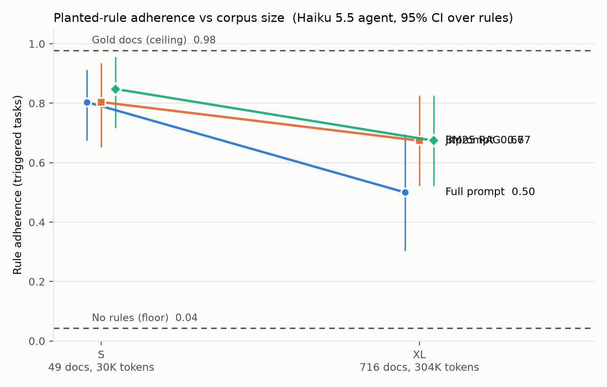
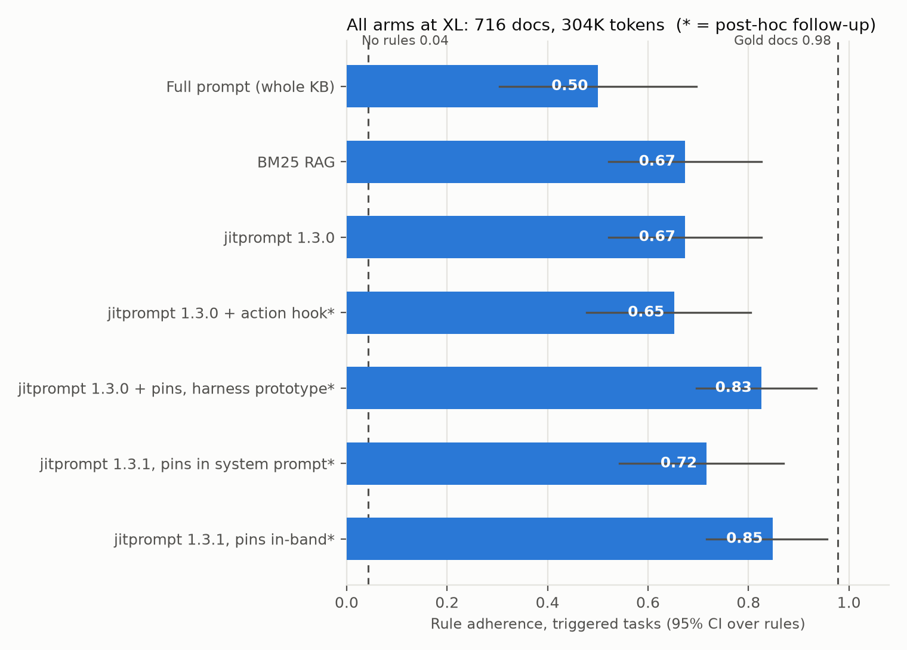

# τ-Banking Rules × jitprompt: planted-rule adherence report (2026-10-15, updated with jitprompt 1.3.1)

**Question.** As an instruction corpus grows, do agents with the whole corpus in the prompt follow specific, conditional business rules less reliably than agents that retrieve only the relevant docs? This is the "tokens are cheap, attention isn't" hypothesis.

**Answer: yes, for a cheap agent at 300K tokens.**
- **The pre-registered primary test supports the hypothesis.** At XL (716 docs, 304K tokens), Haiku 5.5 followed the planted rule in **67% of triggered runs with jitprompt and 50% with the whole KB in the prompt**.
  - In paired (task, trial) runs, jitprompt adhered where full prompt didn't 8 times; the reverse never happened. Exact McNemar p = 0.008, n = 46 pairs.
- **The whole-KB prompt is what degrades.** Its adherence fell from 0.80 at S (49 docs, 30K tokens) to 0.50 at XL (16–2, p = 0.001). At S, all three arms are level (0.80–0.85).
- **The gain is attention, not retrieval.** jitprompt surfaced the rule doc in 96% of its XL runs. Most retrieval-arm misses at XL had the rule doc in hand and didn't follow it: 13 of 15 for jitprompt, 12 of 15 for BM25.
- **jitprompt and BM25 tied at XL** (both 0.67; 4–4 discordant pairs). Both still lose ground from S to XL (jitprompt 0.85 → 0.67, p = 0.039), so retrieval narrows the gap without closing it.
- **Retrieval is also ~17× cheaper at XL:** $0.008–0.009 per run, against $0.148 for full prompt.
- **Follow-up (post-hoc): a small always-present core fixes jitprompt's main failure.** Most of jitprompt's XL misses were the agent failing to find the account-lookup tool. Pinning two core docs (~2K tokens) fixed that.
  - In jitprompt **1.3.1**, with the pins delivered in-band, adherence at XL rose to **0.85**: 9–1 vs jitprompt 1.3.0 (p = 0.021) and 10–2 vs BM25 (p = 0.039).
  - Delivering the same pins through the system prompt scored 0.72, not significantly different from either.
  - See "Follow-up experiments" below.

## Setup
- **Benchmark.** τ²-bench `banking_knowledge`. Upstream tools, grader and user simulator are unchanged.
- **Planted rules.** 24 conditional business rules, written in the KB's own style and checkable deterministically from the tool-call trace (`check_rules.py`; no LLM judge).
  - Each rule has a **triggered** task (the rule changes the correct action) and a **control** task (one fact differs, so applying the rule is wrong).
  - The rules span six types, with four rules each: threshold, prohibition, exception, superseded, near-duplicate and ordering. They cover credit cards (15) and bank accounts (9).
  - The rule text sits in 36 docs: 18 standalone docs, and 18 buried as an extra section in an existing product doc.
  - R05 was dropped at Gate 2 (see Caveats), leaving 23 rules and 46 tasks.
- **Validity checks (Gate 2).** Sonnet 5.5 with the gold docs followed every rule and false-triggered on no control. Haiku without the rule text followed 0 of 23 rules in that check. In the main run the no-rules reference reaches 0.04: two rules (R08, R10) were each followed by chance in one trial.
- **Tiers** (Haiku tokenizer, full system prompt):

| Tier | Contents | Docs | Prompt tokens |
|---|---|---|---|
| S | union of the 48 tasks' required docs, rule versions | 49 | 29,848 |
| XL | all 698 upstream docs, buried rule copies swapped in, plus 18 standalone rule docs | 716 | 303,500 |

- **Arms.** Only knowledge delivery differs between them; prompt caching is on everywhere.
  - **full_prompt:** the tier KB as a cached system-prompt prefix, sorted by id. Rules were not repositioned per task.
  - **rag_bm25:** upstream `bm25_grep`.
  - **jitprompt:** production jitprompt **1.3.0**, `catalog` profile, one namespace per tier (duplicated from t-bank's XL; rule docs ingested as-is).
- **References**, on the S task set: **required_docs** (each task's gold docs inlined; the ceiling) and **no_rules** (gold docs with the rule text removed; the floor).
- **Models.** Agent: Claude Haiku 5.5, thinking disabled. User simulator: Claude Sonnet 5.5 (`between_tools`).
- **Trials.** k = 2 for every cell: 46 tasks × 2 trials per cell. This yields 46 paired triggered observations per comparison.

## Results

**Adherence on triggered tasks** (95% bootstrap CI, resampling rules), with the false-trigger rate on controls:

| Arm | S adherence | XL adherence | False triggers S → XL | Rule doc retrieved XL | $/run XL |
|---|---|---|---|---|---|
| full_prompt | 0.80 [0.67, 0.91] | **0.50** [0.30, 0.70] | 0.09 → 0.13 | (in prompt) | $0.148 |
| rag_bm25 | 0.80 [0.65, 0.93] | 0.67 [0.52, 0.83] | 0.04 → 0.13 | 0.93 | $0.009 |
| jitprompt | 0.85 [0.72, 0.96] | **0.67** [0.52, 0.83] | 0.04 → 0.11 | 0.96 | $0.008 |
| required_docs (ceiling) | 0.98 | | 0.04 | | $0.009 |
| no_rules (floor) | 0.04 | | 0.09 | | $0.007 |

**Paired comparisons on triggered runs** (`results/paired.csv`). "Wins–losses" counts the pairs where only the first arm adhered vs only the second.

| Comparison | Wins–losses | Exact McNemar p |
|---|---|---|
| **jitprompt vs full_prompt @ XL (primary)** | **8–0** | **0.008** |
| rag_bm25 vs full_prompt @ XL | 10–2 | 0.039 |
| jitprompt vs rag_bm25 @ XL | 4–4 | 1.0 |
| full_prompt S vs XL | 16–2 | 0.001 |
| jitprompt S vs XL | 10–2 | 0.039 |
| rag_bm25 S vs XL | 9–3 | 0.146 |
| Any two arms @ S | ≤ 7–5 | ≥ 0.75 |

**By rule type at XL** (adherence: full / BM25 / jitprompt):

| Type | full / BM25 / jitprompt |
|---|---|
| exception | 0.00 / 0.62 / 0.25 |
| superseded | 0.38 / 0.38 / 0.62 |
| ordering | 0.25 / 0.50 / 0.50 |
| threshold | 0.75 / 0.75 / 0.88 |
| near_duplicate | 0.75 / 0.88 / 0.88 |
| prohibition | 1.00 / 1.00 / 1.00 |

- **Rules that need two docs suffer most in the full prompt.** An exception rule's override and a superseded rule's newer date sit in a different doc from the base rule. Full prompt followed **none** of the exception rules at XL.
- **Prohibitions survive everywhere.**

**Why bank-account rules collapse at XL: the agent can't find the account.** Full prompt at XL followed bank-account rules 0.19 of the time (n = 16) against 0.67 for credit-card rules (n = 30). Sorting by id puts the bank-account rules at the start of the prompt, but the transcripts show position isn't the main cause:
- Every bank-account task needs an account id, which only the discoverable tool `get_all_user_accounts_by_user_id_3847` returns. It is documented in one KB doc (`bank_accounts_(general)_009`).
- Agents that don't find it call `get_credit_card_accounts_by_user`, see only cards, conclude "I have no tool to look up bank accounts", and transfer the customer. The rule is never reached.
- On bank-account tasks the lookup was used in 26 of 32 full-prompt runs at S, but only **4 of 32 at XL**, although its doc is in the prompt every time. That is the stuffing effect applied to tool discovery.
- jitprompt at XL used it in 9 of 32 runs and surfaced the tool's name in only 10, against 20 for BM25. Its searches ("refunding an overdraft fee") return the topic without the prerequisite. This was jitprompt 1.3.0's main weakness in this run; pinning the doc in 1.3.1 fixes it (see "Follow-up experiments").
- Position may still play a part for the full prompt, but this design can't isolate it.

**Secondary metrics.**
- **Task pass** (tau2's DB-state grader) is low in every cell (0.05–0.15; pass^2 ≤ 0.04). That holds even for the gold-docs ceiling (0.05), so it doesn't separate the arms.
  - Haiku often logs the verification record twice or with the wrong timestamp, or writes its own free-text closure reason. Each of these changes the database the grader compares, so the run fails.
  - Rule adherence is scored from the action trace, so these slips don't affect it.
- **Control tasks were handled correctly** 0.78–0.87 of the time at S and 0.57–0.63 at XL. Most of the XL errors are not false triggers but unfinished or different actions.

## Follow-up experiments (post-hoc, after the pre-registered study)
These ran after the main results were known. They target the failure the main run exposed. Each was pre-registered in the run log ([`PROGRESS.md` in the first commit](https://github.com/jitprompt/tau-banking-rules/blob/07555e2be6a4d77110b0083fa4e7fb8ba4436e76/PROGRESS.md)) before it ran, with a design and success criterion fixed in advance. All are at XL, k = 2, 46 tasks, same agent and user models, compared on the same 46 triggered (task, trial) pairs.

| Arm (XL) | Adherence [95% CI] | vs jitprompt 1.3.0 | vs BM25 | False triggers | Account lookup used (bank-account tasks, of 32) |
|---|---|---|---|---|---|
| Full prompt | 0.50 [0.30, 0.70] | 0–8 | 2–10 | 0.13 | 4 |
| BM25 | 0.67 [0.52, 0.83] | 4–4 | | 0.13 | 15 |
| jitprompt 1.3.0 | 0.67 [0.52, 0.83] | | 4–4 | 0.11 | 9 |
| + action hook (1.3.0) | 0.65 [0.48, 0.80] | 5–6, p = 1.0 | 6–7, p = 1.0 | 0.09 | not measured |
| + pinned docs, harness prototype (1.3.0) | 0.83 [0.70, 0.93] | 9–2, p = 0.065 | 8–1, p = 0.039 | 0.09 | 23 |
| **1.3.1, pins in the system prompt** | 0.72 [0.54, 0.87] | 8–6, p = 0.79 | 7–5, p = 0.77 | 0.04 | 30 |
| **1.3.1, pins in-band** | **0.85 [0.72, 0.96]** | **9–1, p = 0.021** | **10–2, p = 0.039** | 0.04 | 29 |

The win–loss columns count triggered pairs where only the row's arm adhered vs only the comparison arm (exact McNemar).

**1. Action hook (no effect).**
- Design:
  - before each write call, show the doc sections that mention that tool or its enum values, then let the call through on the next attempt;
  - a literal-match prototype of "retrieve by the action, not the topic".
- Result: 0.65 vs 0.67, p = 1.0.
- An offline replay had predicted this. Most misses had no write call to intercept, because the agent stalled earlier, or the rule was already in context.

**2. Pinned core docs, harness prototype.**
- Design:
  - two docs appended to jitprompt's system prompt: `bank_accounts_(general)_009` (how to look up a customer's accounts) and `_042` (human-transfer reason codes), ~1K tokens;
  - everything else retrieved as before.
- Result: 0.83.
  - Bank-account rules went from 7/16 to 13/16.
  - Credit-card rules were unchanged.
  - The pre-registered test against jitprompt 1.3.0 just missed (p = 0.065).

**3. jitprompt 1.3.1: server-side pins.**
- Design:
  - jitprompt 1.3.1 lets a namespace admin pin documents (cap 2,000 estimated tokens; here 009 + 042, 1,949). The server delivers them two ways:
    - as MCP `instructions` on connect, which clients such as Claude Code put in the system prompt;
    - in-band, at the top of the first `get_toc` or `search_instructions` response of each session, for clients that ignore `instructions`.
  - Clients on an allowlist get only the `instructions` copy.
  - The server renders the pins with section ids, so they are ~20% longer than the prototype's (5,263 vs 4,331 characters).
  - Both paths were tested. Delivery was verified per run:
    - the block was in all 92 system prompts, with no in-band copy;
    - and on the first jitprompt call of all 92 in-band conversations, never repeated.
- Results:
  - **Both paths fixed the stall.** The account lookup was used in 30 and 29 of 32 bank-account runs, against 9 for 1.3.0.
  - **In-band: 0.85.** It beats 1.3.0 (9–1, p = 0.021) and BM25 (10–2, p = 0.039). Bank-account rules 15/16, credit-card rules 24/30.
  - **System prompt: 0.72.** The pre-registered primary (vs 1.3.0, p < 0.05) was **not met** (8–6, p = 0.79). Bank-account rules 11/16, credit-card rules 22/30.
  - It is not significantly different from in-band (3–9, p = 0.15) or from the prototype (2–7, p = 0.18). Its shortfall is spread over four rules (R02, R10, R16, R17).
  - At 46 pairs, whether system-prompt or in-band delivery yields better adherence is unresolved.
  - **False triggers fell** to 0.04 in both 1.3.1 arms, against 0.11 for 1.3.0.

**What the follow-ups show.**
- Pure retrieval misses what the agent doesn't know to ask for. Here that was the procedure for finding an account id, which every bank-account task depends on.
- A full prompt contains it but loses it in the noise.
- A small, always-present core of a few procedures, plus retrieval for everything else, beat both.
- The claim "stop stuffing your system prompt" therefore holds with a refinement: keep the system prompt to the core procedures, and retrieve the rest.

**Caveats specific to the follow-ups.**
- The pinned docs were chosen from this run's own failure analysis, so the gain is in-sample. A held-out corpus with rules written by someone else is needed before treating it as general.
- The follow-up arms ran after the main grid, not interleaved with it.
- Several comparisons were run without multiple-testing correction. Read the p-values as indicative.
- tau2's "discoverable tools" exaggerate the stall. In most deployments the lookup tool would be in the agent's tool list.

## Caveats
- **Power.** The primary test rests on 23 rules × 2 trials. 8–0 is a clean result, but the CIs on the per-arm rates are wide (±0.2). jitprompt vs BM25 is a tie, not evidence of equivalence.
- **One cheap agent.** Haiku 5.5 with thinking off; t-bank found no degradation with Sonnet 5.5 on task success. The effect may shrink with stronger models (the optional Sonnet-at-XL contrast was not run).
- **Position.** Positions came from sorted ids and were never randomised, by design, so the cached prefix stays byte-identical within a tier. Rule position is confounded with category, and the bank-account drop is mostly the account-lookup stall (see above).
- **Retrieval was easy.** The rules were written to be retrievable and the agent queries named the deciding facts. jitprompt retrieved the rule doc in 96% of XL runs. A retriever under more pressure (vaguer plans, more look-alike docs) could lose some of the advantage.
- **R05 dropped** (user decision, Gate 2). Without the rules, Haiku complied on 2 of 2 runs, by falling back to a transfer after failing to unlock the closure tool. Its doc stayed in the corpus as a distractor.
- **jitprompt tuning.** jitprompt 1.3.0 and the `catalog` profile were tuned on t-bank's queries over the same base corpus (not on these rules).
- **Ingestion bug.** On ingestion, two uploads failed intermittently on the server. They succeeded on retry: one of them took two retries in RULES_S and one in RULES_XL.
- **Spend:** $27.36 of the $90 cap.

  | Item | Cost |
  |---|---|
  | Gate 2 validity checks, including re-runs | $4.14 |
  | Pilot, trial 1 | $8.85 |
  | Trial 2 | $10.50 |
  | Replay plans | $0.005 |
  | Follow-up: action hook | $1.29 |
  | Follow-up: pinned docs, harness prototype | $0.89 |
  | Follow-up: jitprompt 1.3.1, both delivery paths | $1.68 |

  jitprompt's own ingestion cost is excluded.

A focused two-arm version (full prompt vs jitprompt) is `REPORT_full_vs_jitprompt.md`.

Files: `results/{runs,summary,paired,by_type,by_position,attribution}.csv`, `results/xl_arms.png`, `results/replay/replay_plans.csv`, `RULES_TABLE.md`, `DEVIATIONS.md`. Code is in `tau2-bench/jitprompt_rules/`, on branch `jitprompt-rules`.
