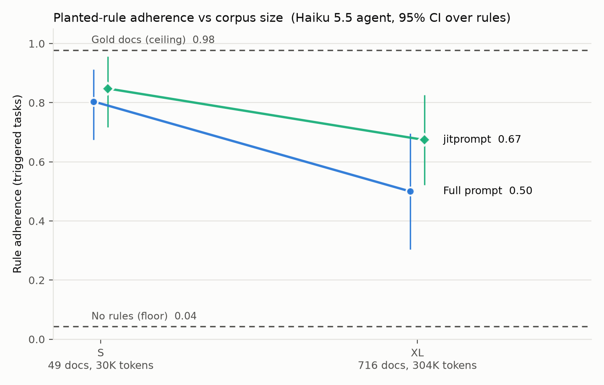

# Stop stuffing your system prompt: full prompt vs jitprompt on planted business rules (2026-10-15)

**Claim.** Putting your whole instruction corpus in the system prompt is a reliability problem, not just a cost problem. As the corpus grows, the agent misses the specific rule that applies, even when it has that rule in context.

**Evidence.** We planted 23 conditional business rules in a 716-document banking knowledge base (304K tokens) and ran a Claude Haiku 5.5 agent through 46 tasks, twice each.

| | Full prompt (whole KB in the system prompt) | jitprompt (retrieve only what's relevant) |
|---|---|---|
| Rule followed, small KB (49 docs, 30K tokens) | 0.80 | 0.85 |
| **Rule followed, large KB (716 docs, 304K tokens)** | **0.50** | **0.67** |
| Prompt tokens per conversation, large KB | ~2.35M | ~0.14M |
| Cost per conversation, large KB | $0.148 | $0.008 |

- **Same agent, same tasks, opposite trajectories.** With the whole KB in the prompt, adherence fell from 0.80 to 0.50 as the KB grew 10× (16–2 on paired runs, p = 0.001).
- **Head to head on the large KB,** jitprompt followed the rule where the full prompt didn't **8 times; the reverse happened 0 times** (exact McNemar p = 0.008, 46 paired runs). This was the pre-registered primary test.
  - Rule by rule, jitprompt was never worse than the full prompt, and it was better on 8 of the 23 rules.
- **It costs 17× less,** because the agent reads about 140K tokens per conversation instead of 2.35M.

## Why this matters: the full prompt had the rule and still missed it
The full-prompt agent never lacks information: every rule is in its context on every turn. Yet at 304K tokens it followed only half of them. The failures concentrate in rules that need the agent to connect two pieces of text:

| Rule type (large KB) | Full prompt | jitprompt |
|---|---|---|
| Exception (a rule in one doc, its override in another) | 0.00 | 0.25 |
| Superseded (old policy vs newer dated update) | 0.38 | 0.62 |
| Ordering (check X before doing Y) | 0.25 | 0.50 |
| Threshold (a cap on an amount) | 0.75 | 0.88 |
| Look-alike products (Gold vs Platinum values) | 0.75 | 0.88 |
| Prohibition (never do X; escalate instead) | 1.00 | 1.00 |

Simple prohibitions survive a stuffed prompt. Exceptions, superseded policies and procedure ordering don't, and they are exactly the rules real operations teams write.

## How the test works
- **Rules.** 24 conditional rules (23 used) written in the knowledge base's own style.
  - Each sits either in a new document or as an extra section buried in an existing product doc.
  - Examples: "late-fee reversals on the Bronze card are capped at $25"; "from 10/01 the Platinum credit-limit request cap is $2,000, not $5,000"; "a stolen card's replacement may only ship to the address on file".
- **Tasks.** Each rule has a **triggered** task, where the rule changes the right action, and a **control** task, where one fact differs so applying the rule is wrong.
  - A customer is played by Claude Sonnet 5.5.
  - Adherence is scored deterministically from the agent's actual tool calls (amounts, arguments, order); no LLM judge.
- **Validity checks.**
  - With exactly the right documents, the agent follows the rules 98% of the time.
  - With the rule text removed, it follows them 4% of the time. The rules really change behaviour, and the agent can follow them when it sees them.
- **Two arms, identical except for how knowledge is delivered.**
  - **Full prompt:** the whole knowledge base in a cached system prompt.
  - **jitprompt 1.3.0:** the same documents, retrieved on demand via `get_toc` / `search_instructions` / `get_section`.
- **Benchmark.** τ²-bench `banking_knowledge`, with its tools, user simulator and grader unchanged.
- **Agent.** Claude Haiku 5.5, thinking off, 2 trials per task.

## What this does and does not show
- **It shows retrieval beats stuffing for a cost-efficient agent at 300K tokens.** It does not show that every model degrades: an earlier run with the stronger Sonnet 5.5 on task success found no degradation. Smaller, cheaper models, the ones you'd want to run at scale, are where it bites.
- **The advantage is attention, not search.** jitprompt retrieved the right rule document in 96% of large-KB runs. Even then, 13 of its 15 misses had the rule in hand. Retrieval narrows the gap with the ideal case (0.98) without closing it, and jitprompt also drops from 0.85 to 0.67 as the KB grows.
- **It's about not stuffing, not about one retriever.** A plain BM25 retriever over the same corpus matched jitprompt at 304K tokens (0.67). The win comes from giving the agent less to read. jitprompt delivers that on production infrastructure, but the evidence is against stuffing in general.
- **Stuffing also hides tools, not just rules.** Every bank-account task needs the customer's account id, which one discoverable tool returns. With the whole KB in the prompt, the agent found that tool in 26 of 32 bank-account runs on the small KB and only 4 of 32 on the large one, though its doc was in context every time. jitprompt did better (9 of 32) but still often missed it, because retrieval returned the topic without the prerequisite. Most of the large-KB failures on bank-account rules are this, not the rule itself.
- **Scale of the evidence.** 23 rules × 2 trials. The 8–0 result is unlikely to be chance (p = 0.008), but per-arm rates carry ±0.2 confidence intervals.

The full three-arm report (with BM25), tables and code: `REPORT.md`, `results/`, `tau2-bench/jitprompt_rules/`.
